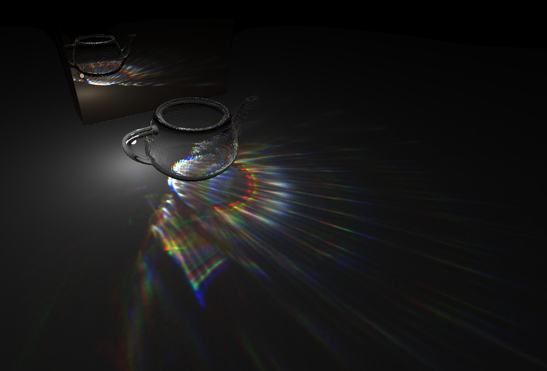
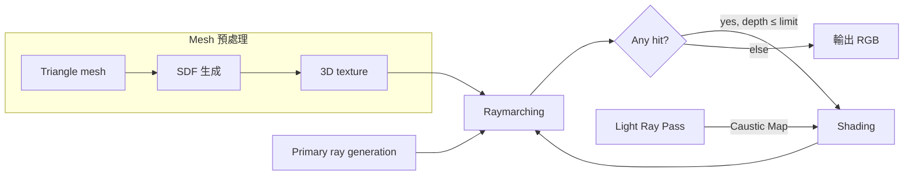
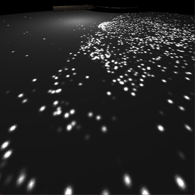
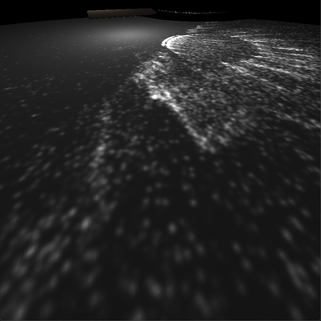
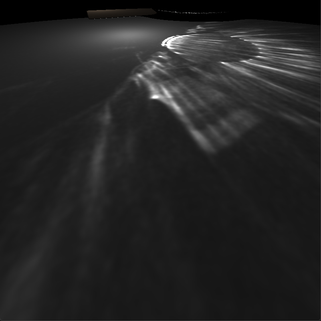
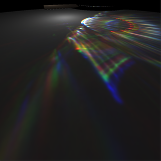
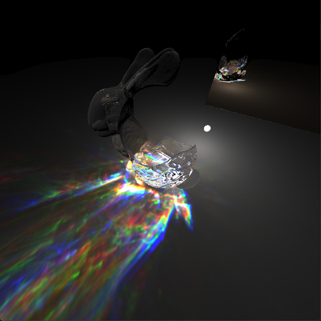

# RaytracingDistanceField

以 Signed Distance Field（SDF）表示透明物體的 ray tracer，透過 Caustic Map 繪製複雜形狀造成的焦散（caustics）與色散（dispersion）。以 OpenGL compute shader 實作、GPU 加速。

> 國立臺灣海洋大學 資訊工程學系 專題研究｜陳宏勝｜指導教授：翁世光

## 動機

實驗室既有的 ray tracer 中，焦散始終只是一顆玻璃球在地上形成的圓點，但形狀複雜的透明物體產生的焦散應該更豐富。這個專案以 SDF 中距離為 0 的等值面（iso-surface）表示透明物體，繪製它們的焦散與色散。選擇 SDF，是因為對距離值取 min／max 就能做 Constructive Solid Geometry（CSG），容易組合出更複雜的物體。

## 方法

1. **SDF 生成**：把三角片模型的 AABB 切成 128³ 的規則網格，計算每個網格中心到物體表面的最短距離並存進 3D texture。以 generalized winding number [1] 判斷網格中心是否在物體內部，內部的距離記為負值；surface normal 由 ∇φ 求得。
2. **Primary Pass（Raymarching）**：場景的 SDF 為各物體 SDF 的最小值 φs(x) = mini φi(x)。ray 每一步前進 |φs| 求交點 [2][3]；打到透明物體時，依 surface normal 與折射率產生折射 ray 再回到 raymarching，直到打到粗糙表面、折射次數超過上限，或沒有打到任何物體。
3. **Light Ray Pass**：從點光源朝隨機方向發射 N 條 light ray，每條帶光源總能量的 1/N。只記錄 LS⁺D 路徑（從光源出發、至少經過一次透明物體、最後打到粗糙表面），依落點的 uv 把能量累加到該粗糙表面專屬的 2D texture，也就是 Caustic Map（概念參考 [4]）。Primary Pass 打到粗糙表面時讀取 Caustic Map，把焦散的能量加進光照。
4. **色散**：R、G、B 三種顏色的 light ray 使用不同的折射率。

## 成果

影像 800×800，每個 pixel 一條 primary ray。(a)–(c) 使用單一折射率，light ray 越多，Caustic Map 上的雜點越少；(d) 讓 R、G、B 使用不同折射率而產生色散。

| (a) 40K 條 | (b) 400K 條 | (c) 4M 條 | (d) 每色 16M 條（含色散） |
|:-:|:-:|:-:|:-:|
|  |  |  |  |

(d) 在 RTX 2060 上繪製一張約需 30 秒。為了凸顯色散，折射率刻意設為 R = 1.5、G = 1.4、B = 1.3，各顏色的差距遠大於真實玻璃。

CSG 範例：把兔子的 SDF 與背上球體的 SDF 做差集，即 max{φbunny, −φsphere}。

## 限制與後續工作

- 焦散目前只能呈現在有 uv 座標的粗糙表面（例如地板、牆面）上。
- 每個物體只有一張固定解析度的 SDF，細節受限於解析度，提高解析度又會讓記憶體以三次方成長。之後想把同一個物體分成多個區域，細節多的區域使用較高解析度（LOD），並以 BVH 管理。
- 移植到 Vulkan，把各區域的 AABB 交給 RT Core 做硬體加速的 BVH 走訪，只在打到的區域內做 raymarching。

## 開發環境

Windows、Visual Studio 2022（`RaytracingDistanceField.sln`）、OpenGL compute shader、GLFW、Dear ImGui。SDF 生成程式與碰撞專題 [cg_project](https://github.com/asd7766zxc/cg_project) 共用。

## 參考文獻

1. A. Jacobson, L. Kavan, and O. Sorkine-Hornung, "Robust Inside-Outside Segmentation using Generalized Winding Numbers," *ACM Transactions on Graphics*, vol. 32, no. 4, 2013.
2. J. C. Hart, "Sphere Tracing: A Geometric Method for the Antialiased Ray Tracing of Implicit Surfaces," *The Visual Computer*, vol. 12, no. 10, 1996.
3. K. Crane, "Ray Tracing Quaternion Julia Sets on the GPU," University of Illinois at Urbana-Champaign, 2005.
4. C. Wyman and S. Davis, "Interactive Image-Space Techniques for Approximating Caustics," in *Proc. ACM SIGGRAPH Symposium on Interactive 3D Graphics and Games (I3D)*, 2006.
